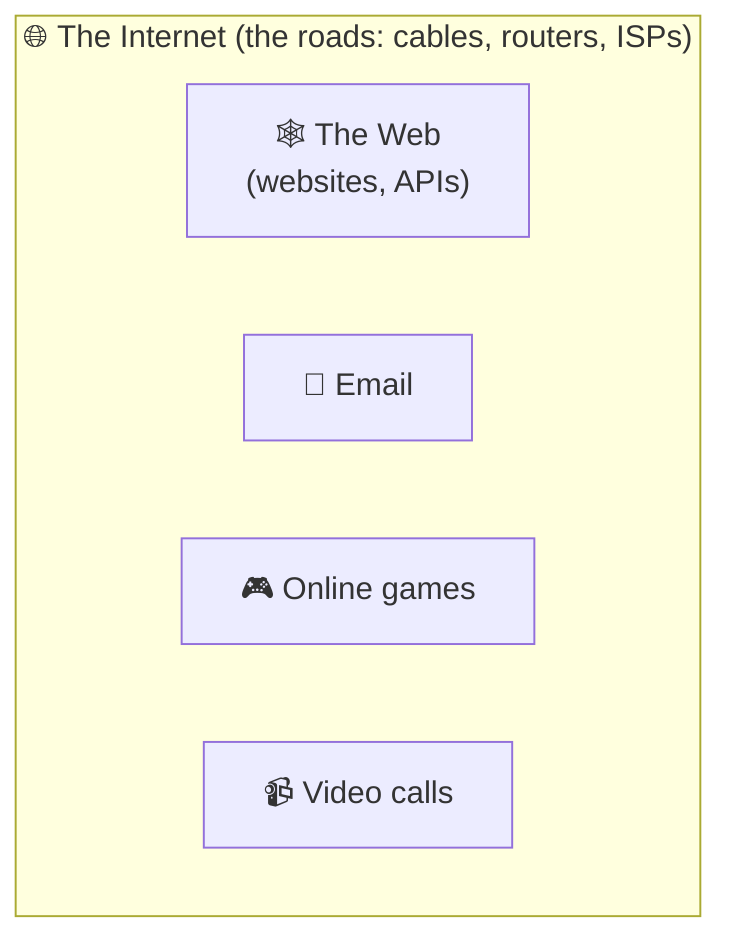
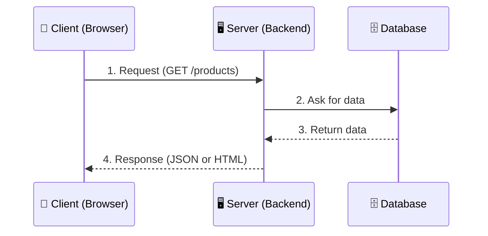
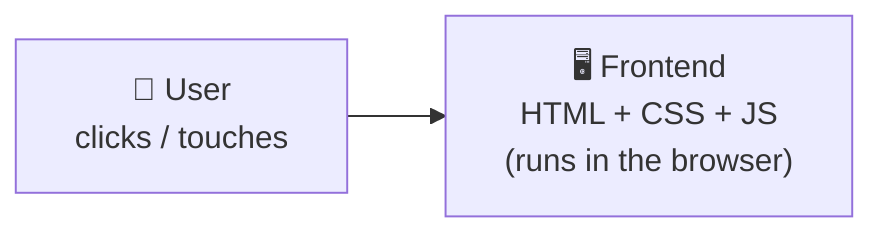
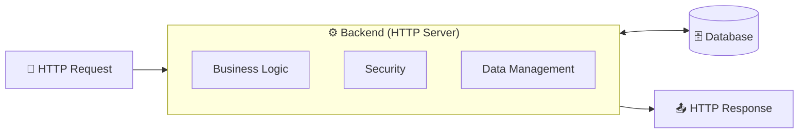
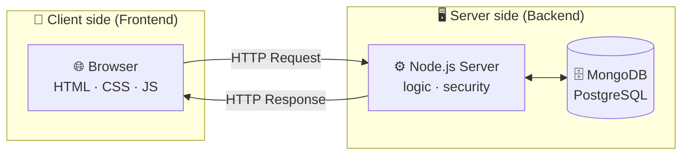
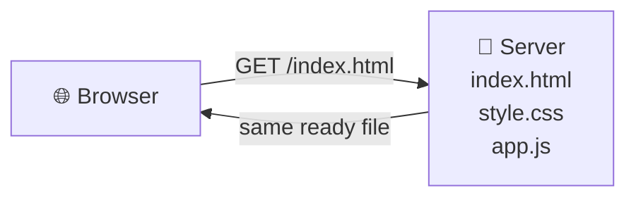
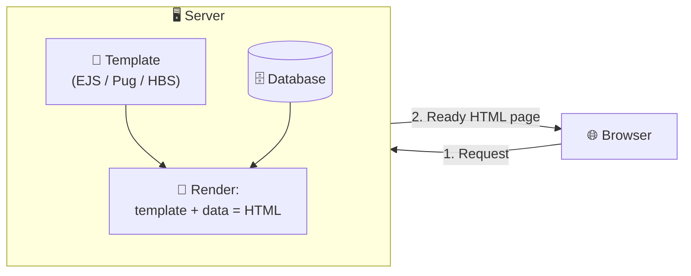
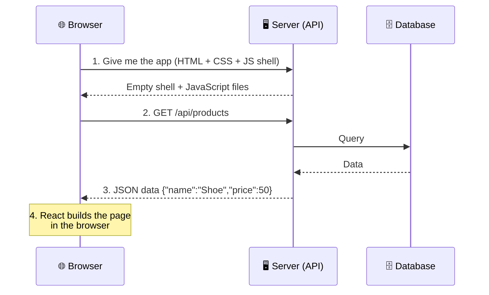
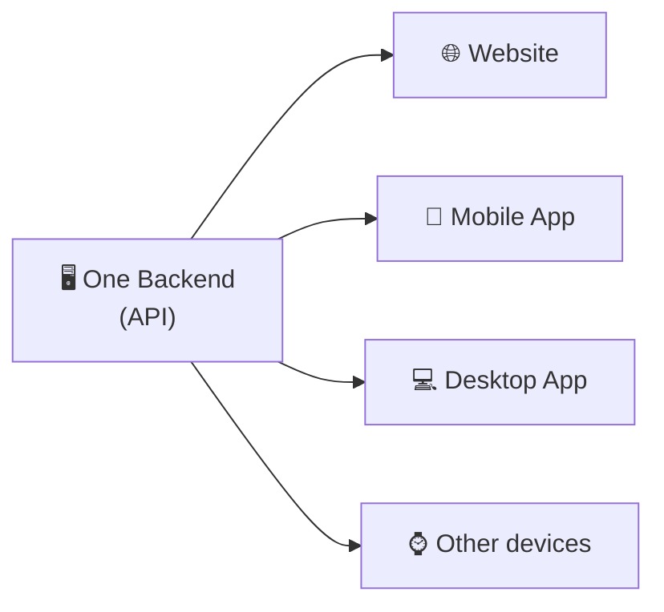

# 01-web-fundamentals: How the Web Really Works

> **Backend Zero to Expert** · Module 01 · English + বাংলা


---

## 📑 What is in this module

| Part | Topic |
|---|---|
| **1** | **The Big Picture** (this part) |
| 2 | Networking: IP, Port, Packet, TCP, UDP, Socket |
| 3 | URL, DNS and "what happens when you type a URL" |
| 4 | HTTP deep dive: request, response, methods, headers, status codes |
| 5 | HTTPS, cookies, caching, CORS, HTTP versions, DevTools |
| 6 | Practice, mini project, interview questions, resources |

### 🎯 Learning goals

**English:** By the end of this module you will be able to explain, draw and debug everything that happens between a browser and a server, which is the foundation of all backend work.

**বাংলা:** এই module শেষে browser আর server এর মধ্যে যা যা ঘটে সব তুমি ব্যাখ্যা করতে, আঁকতে এবং debug করতে পারবে। এটাই backend এর ভিত্তি।

### ✅ Prerequisites

Complete [00-setup](../00-setup). Nothing else needed.

---

## 1. The Big Picture

### 1.1 Internet vs Web (they are not the same!)

**English:** Many people use these words as if they mean the same thing. They do not.

- The **Internet** is the global **network of connected computers** (the roads, cables, routers).
- The **Web** (World Wide Web) is a **service that runs on the Internet**: websites, pages and APIs we open with a browser (the shops and offices on those roads).
- Email, online games and video calls also use the Internet, but they are not "the Web".

**বাংলা:** Internet হলো সারা পৃথিবীর computer এর সংযুক্ত **network** (রাস্তা, cable, router)। Web হলো Internet এর উপর চলা একটা **service**: website, page, API (রাস্তার ধারের দোকান ও অফিস)। Email আর online game ও Internet ব্যবহার করে, কিন্তু সেগুলো "Web" না।



> 📚 **Learn more:** [MDN: How does the Internet work?](https://developer.mozilla.org/en-US/docs/Learn/Common_questions/Web_mechanics/How_does_the_Internet_work) · [Cloudflare: How does the Internet work?](https://www.cloudflare.com/learning/network-layer/how-does-the-internet-work/)

---

### 1.2 The Client-Server Model

**English:** The whole Web is built on one simple idea.

- A **client** asks for something (your browser, mobile app, or Postman).
- A **server** is a computer that is always on, waiting for requests and sending back answers.

Think of a **restaurant**:

| Restaurant | Web |
|---|---|
| You (customer) | **Client** (browser, mobile app) |
| Waiter | **Network / HTTP** (carries request and response) |
| Kitchen | **Server / Backend** (does the real work) |
| Fridge and storage | **Database** |
| Your order | **Request** |
| Your food | **Response** |

**বাংলা:** পুরো Web একটা সহজ ধারণার উপর দাঁড়িয়ে। **Client** কিছু চায় (browser, mobile app, Postman)। **Server** এমন computer যেটা সবসময় চালু থাকে, request এর অপেক্ষা করে আর উত্তর পাঠায়। Restaurant এর মতো ভাবো: তুমি = client, waiter = network, রান্নাঘর = backend, ভাঁড়ার = database।



> **Key point:** The client **always starts** the conversation. A server only **responds**. (Later we will see exceptions like WebSockets.)

> 📚 **Learn more:** [MDN: Client-Server overview](https://developer.mozilla.org/en-US/docs/Learn/Server-side/First_steps/Client-Server_overview) · [MDN: What is a web server?](https://developer.mozilla.org/en-US/docs/Learn/Common_questions/Web_mechanics/What_is_a_web_server)

---

### 1.3 Frontend

**English:** Frontend is everything the user **sees and touches** in the browser: the interface, buttons you click, screens you touch, anything interactive.

**বাংলা:** Browser এ user যা **দেখে এবং ছোঁয়**, সেটাই Frontend: interface, click করার button, touch করার screen, সব interactive জিনিস।

**Core building blocks (the 3 pillars):**

| Pillar | Job | Analogy (human body) |
|---|---|---|
| **HTML** | Structure and content | Skeleton 🦴 |
| **CSS** | Style and layout | Skin and clothes 👕 |
| **JavaScript** | Behavior and logic | Muscles and nerves 💪 |

**Modern frameworks** (they make big UIs easier to build):

[Next.js](https://nextjs.org/) · [React](https://react.dev/) · [Vue](https://vuejs.org/) · [Angular](https://angular.dev/)



> 📚 **Learn more:** [MDN: Learn web development](https://developer.mozilla.org/en-US/docs/Learn)

---

### 1.4 Backend

**English:** Backend is the **brain and powerhouse** of a website. It runs on a **server**, away from the user's eyes. It does three big jobs:

1. **Business logic:** the rules of your app (a user cannot buy if stock is 0)
2. **Security:** who is allowed to do what (login, permissions)
3. **Data management:** saving and reading data from the database

At its core, **a backend is an HTTP server**: a program that listens for HTTP requests and sends back HTTP responses.

**বাংলা:** Backend হলো একটা website এর **মস্তিষ্ক ও শক্তিঘর**। এটা server এ চলে, user এর চোখের আড়ালে। তিনটা বড় কাজ: **business logic** (app এর নিয়ম), **security** (কে কী করতে পারবে), **data management** (database এ data রাখা ও আনা)। মূলত **backend হলো একটা HTTP server**।



**Backend languages and runtimes** (you can build a backend in almost any language):

| Language | Popular framework | Note |
|---|---|---|
| **JavaScript (Node.js)** | [Express](https://expressjs.com/), [Fastify](https://fastify.dev/), [NestJS](https://nestjs.com/) | **We learn this.** Node.js is a JavaScript **runtime environment** |
| Python | [Django](https://www.djangoproject.com/), [FastAPI](https://fastapi.tiangolo.com/) | Great for AI and data |
| PHP | [Laravel](https://laravel.com/) | Powers a big part of the web |
| Ruby | [Rails](https://rubyonrails.org/) | Fast to build with |
| Java | [Spring Boot](https://spring.io/projects/spring-boot) | Very common in big companies |

> 💡 Why Node.js? One language (JavaScript) for both frontend and backend. You will learn how Node works inside in **Module 03**.

> 📚 **Learn more:** [roadmap.sh: Backend Roadmap](https://roadmap.sh/backend)

---

### 1.5 Putting it together



**বাংলা:** User browser এ click করে → frontend server এ HTTP request পাঠায় → backend logic চালিয়ে database থেকে data আনে → response ফেরত পাঠায় → browser সেটা screen এ দেখায়।

---

### 1.6 Static Website

**English:** In a **static website**, the server keeps **ready-made files** (HTML, CSS, JS, images). When a request comes, the server just **sends the same files** to everyone. Nothing is calculated on the server.

- Good for: portfolio, notice board, landing page, documentation
- Limit: cannot easily show different content for different users, and updating means editing the files by hand

**বাংলা:** Static website এ server এ আগে থেকেই তৈরি HTML, CSS, JS file রাখা থাকে। Request এলে সবাইকে **একই file** পাঠানো হয়। Portfolio, notice board এর জন্য ভালো, কিন্তু বারবার update করা কঠিন।



---

### 1.7 Dynamic Website

**English:** In a **dynamic website**, content is **created on demand**, using data from a database and information about the user (your name, your cart, your orders). Two main styles exist.

#### A) Template-based (Server-Side Rendering, SSR)

The **server builds the full HTML page** by mixing a **template** with **database data**, then sends the finished page.

Template engines: [EJS](https://ejs.co/) · [Pug](https://pugjs.org/) · [Handlebars (HBS)](https://handlebarsjs.com/)



**বাংলা:** **Template-based (SSR):** Server নিজেই template আর database data মিলিয়ে পুরো HTML page বানায়, তারপর তৈরি page browser এ পাঠায়। একে **Server-Side Rendering** বলে।

#### B) API-based (Client-Side Rendering, CSR)

The server **only sends raw data** (usually **JSON**) through an **API**. The **browser builds the page** using JavaScript (React, Next.js, etc.).



**বাংলা:** **API-based (CSR):** Server শুধু **কাঁচা data (JSON)** পাঠায়। Browser এ JavaScript (React, Next.js) সেই data দিয়ে page বানায়। একে **Client-Side Rendering** বলে। **এই course এ আমরা মূলত API বানানো শিখব** (Building API)।

Example of what an API sends (JSON):

```json
{
  "id": 1,
  "name": "Running Shoe",
  "price": 50,
  "inStock": true
}
```

---

### 1.8 Why APIs are powerful: one backend, many clients

**English:** If your server sends **data (JSON)** instead of finished HTML pages, **any device can use it**: a website, a mobile app, a desktop app, a smartwatch. You build the backend **once**.

**বাংলা:** Server যদি তৈরি HTML এর বদলে **data (JSON)** পাঠায়, তাহলে যেকোনো device সেটা ব্যবহার করতে পারে: website, mobile app, desktop app। Backend **একবারই** বানাতে হয়।



> 📚 **Learn more:** [Red Hat: What is an API?](https://www.redhat.com/en/topics/api/what-are-application-programming-interfaces) · [MDN: Introduction to web APIs](https://developer.mozilla.org/en-US/docs/Learn/JavaScript/Client-side_web_APIs/Introduction)

---

### 1.9 SSR vs CSR at a glance

| | Server-Side Rendering (SSR) | Client-Side Rendering (CSR) |
|---|---|---|
| Who builds the page? | **Server** | **Browser** (JavaScript) |
| What server sends | Ready HTML | JSON data (plus JS app) |
| First page load | Fast, content is ready | A bit slower (JS must run first) |
| SEO (Google search) | Easy | Harder (needs extra work) |
| Reuse for mobile app? | Hard | **Easy** (same API) |
| Tools | EJS, Pug, HBS, Next.js (SSR) | React, Vue, Angular, Next.js (CSR) |

> 💡 Modern frameworks like Next.js can **mix both**. Our focus is the **backend API**, which works with every style.

> 📚 **Learn more:** [web.dev: Rendering on the Web](https://web.dev/articles/rendering-on-the-web)

---

## 🔬 Try it yourself (5 minutes)

**Task 1: See that a webpage is just text**
1. Open any simple website, right-click → **View Page Source**. This is the HTML the server sent.

**Task 2: See an API response**
1. Open this link in your browser: [jsonplaceholder.typicode.com/users/1](https://jsonplaceholder.typicode.com/users/1)
2. You see **JSON**, not a designed page. That is what an API returns.

**Task 3: Watch the client-server talk**
1. Open any website, press `F12` → **Network** tab → refresh the page
2. Every row is one **request** your browser sent. Click one and look at **Headers** and **Response**.

> 📚 [Chrome DevTools: Network reference](https://developer.chrome.com/docs/devtools/network)

---

## ✅ Part 1 Checkpoint

You should be able to answer these in your own words:

- [ ] What is the difference between the Internet and the Web?
- [ ] Who starts the conversation, the client or the server?
- [ ] What are the 3 jobs of a backend?
- [ ] Static vs dynamic website?
- [ ] SSR vs CSR? Who builds the HTML in each?
- [ ] Why is an API useful for mobile apps?

---

*Next: Part 2, Networking (IP, Port, Packet, TCP, UDP, Socket)*